=== PRAKTIKUM PEMROGRAMAN BERORIENTASI OBJEK ===

Nama    :Dede Hidayatul 'Aziz

NIM     :H1D025036

Aplikasi manajemen rumah sakit yang dirancang untuk menyederhanakan alur pelayanan medis. 
Proyek ini dibuat untuk memenuhi syarat Tugas Akhir Praktikum Pemrograman Berorientasi Objek (PBO).


## Petunjuk Compile & Run

### Prasyarat
- **JDK (Java Development Kit)** minimal versi 8
### Cara Clone
1. Buka terminal/command prompt
2. Clone repository ke lokal:
```bash
git clone https://github.com/jisaziss/sistem-rumah-sakit.git
Masuk ke folder proyek:
cd sistem-rumah-sakit

Atau Download ZIP
1. Kunjungi repository GitHub: https://github.com/jisaziss/sistem-rumah-sakit
2. Klik tombol Code → Download ZIP
3. Ekstrak file ZIP ke folder pilihan
```

#### ALUR SISTEM RUMAH SAKIT
Menjalankan Program
1. Pengguna mengompilasi atau menjalankan program.


2. Memilih Layanan di Menu Utama.

layar menampilkan opsi menu:
- Layanan Berobat: Untuk proses pendaftaran hingga pembayaran pasien.
- Manajemen Pasien: Untuk melihat atau mengelola daftar pasien.
- Rawat Inap: Untuk memasukkan pasien ke fasilitas kamar.
- Informasi RS: Untuk melihat daftar dokter dan tarif.
- Laporan: Untuk melihat total riwayat pembayaran.
- Pengujian PBO: Untuk pembuktian 10 poin.
3. Alur Pelayanan Pasien (Layanan Berobat)
   Jika pengguna memilih opsi berobat:
- Input Data: Pengguna memasukkan nama, umur, dan alamat pasien.
- Pilih Dokter: Pengguna memilih dokter yang akan memeriksa.
- Pilih Keluhan/Diagnosis: Pengguna memilih penyakit/gejala dari daftar yang tersedia.
- Terima Resep: Sistem otomatis menentukan obat dan tindakan medis yang sesuai.
- Pembayaran: Rincian biaya (jasa dokter, obat, administrasi) muncul di layar, pengguna mengonfirmasi pembayaran.
4. Selesai
   Pengguna dapat kembali ke menu utama untuk transaksi lain, atau memilih angka 0 untuk keluar dari aplikasi.

   
## SCREENSHOT LUARAN PROGRAM

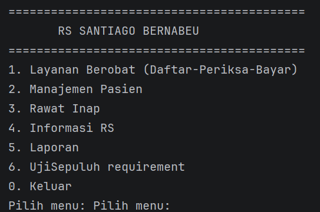

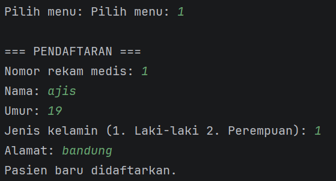

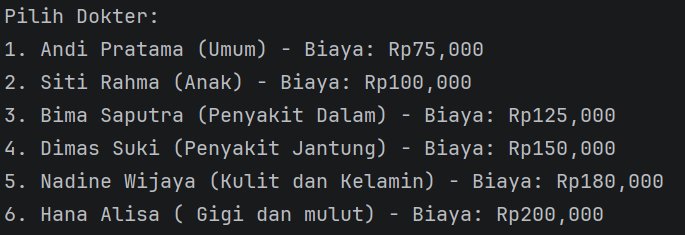

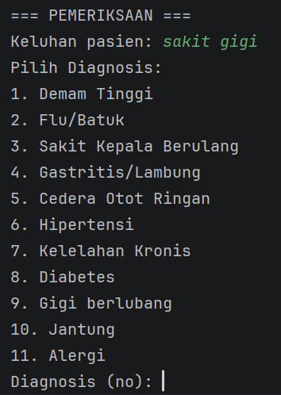

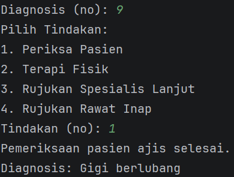

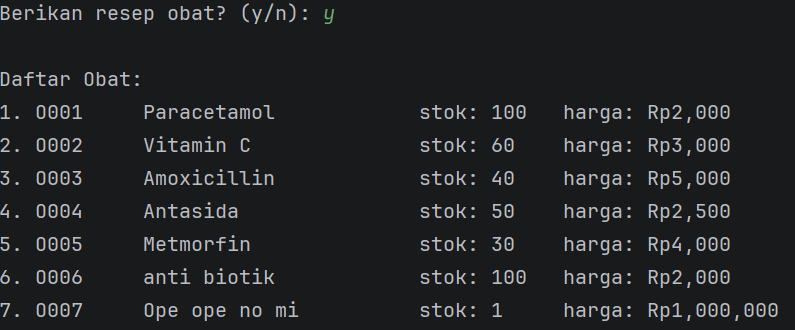

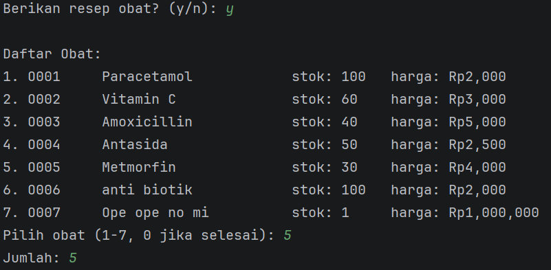

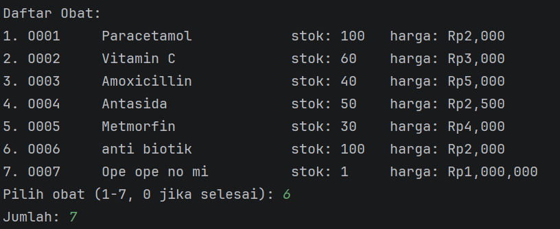

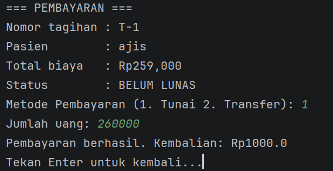

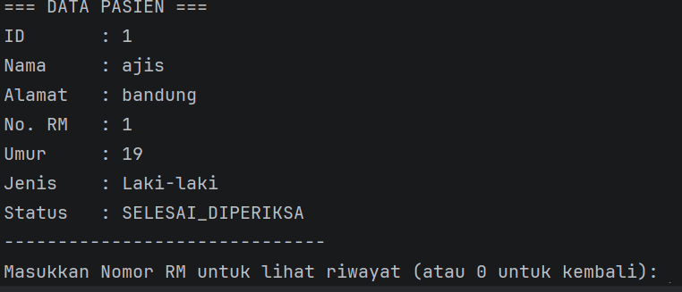

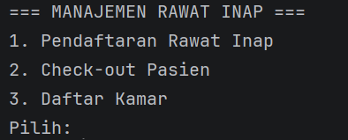

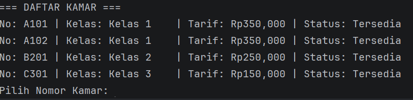

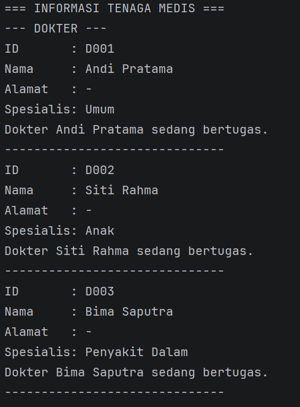

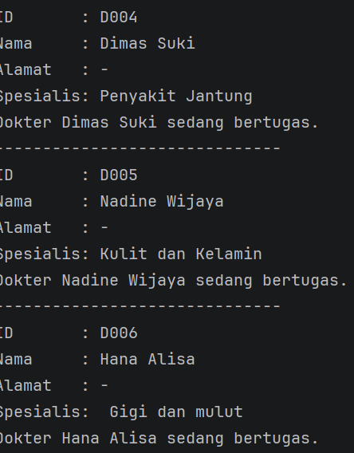

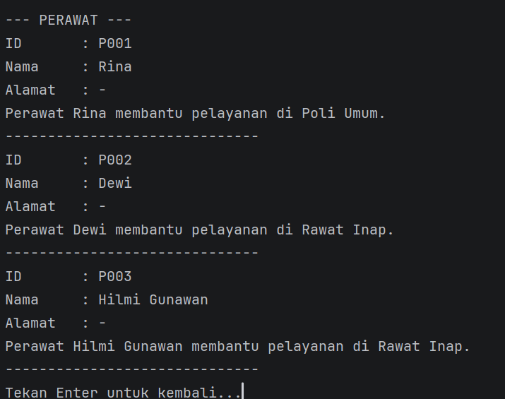

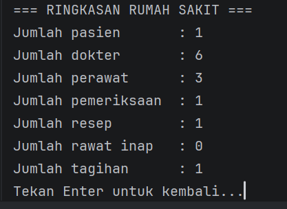

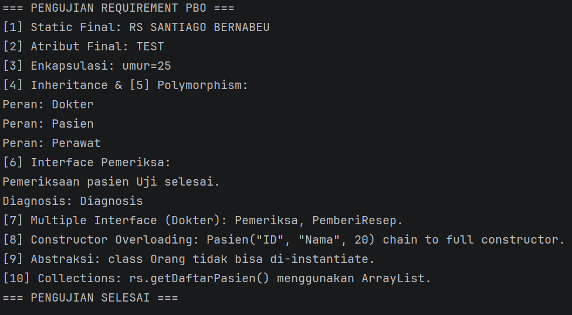


